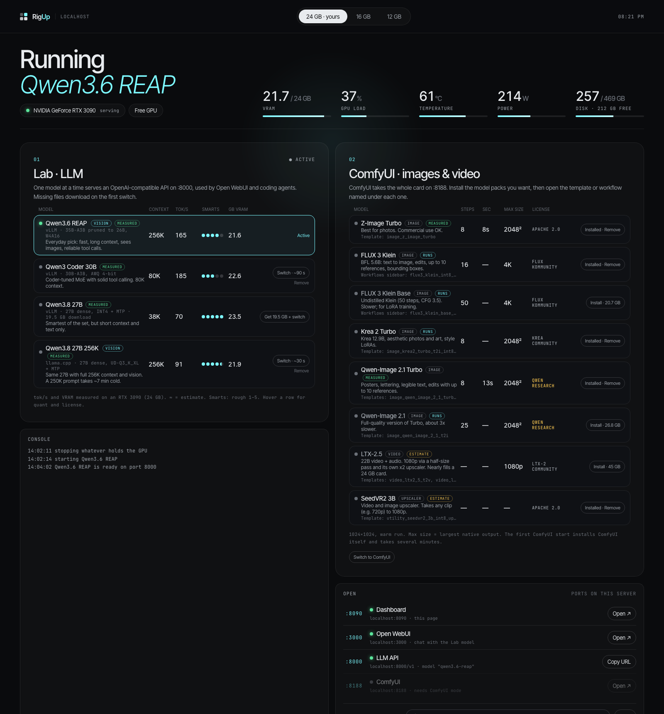
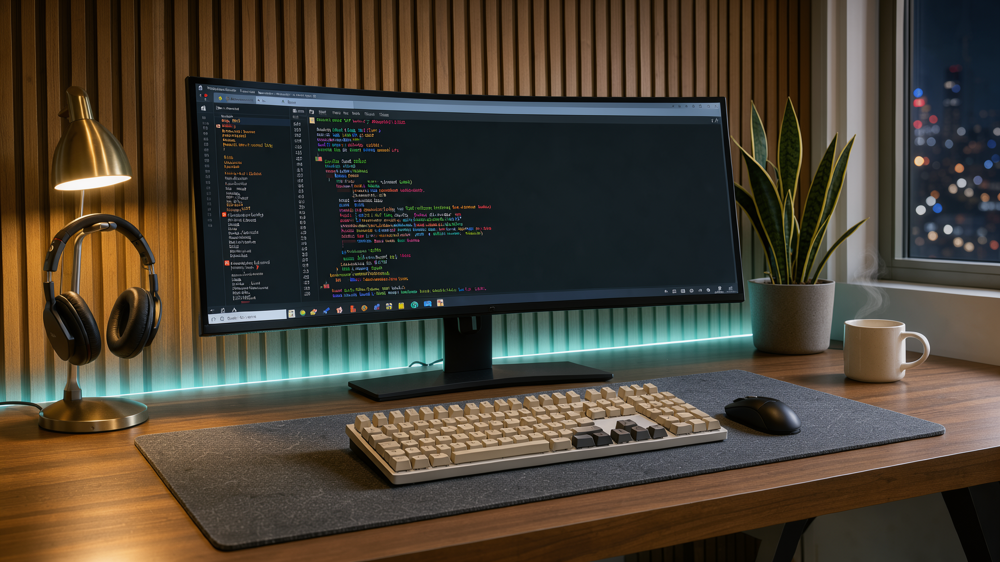
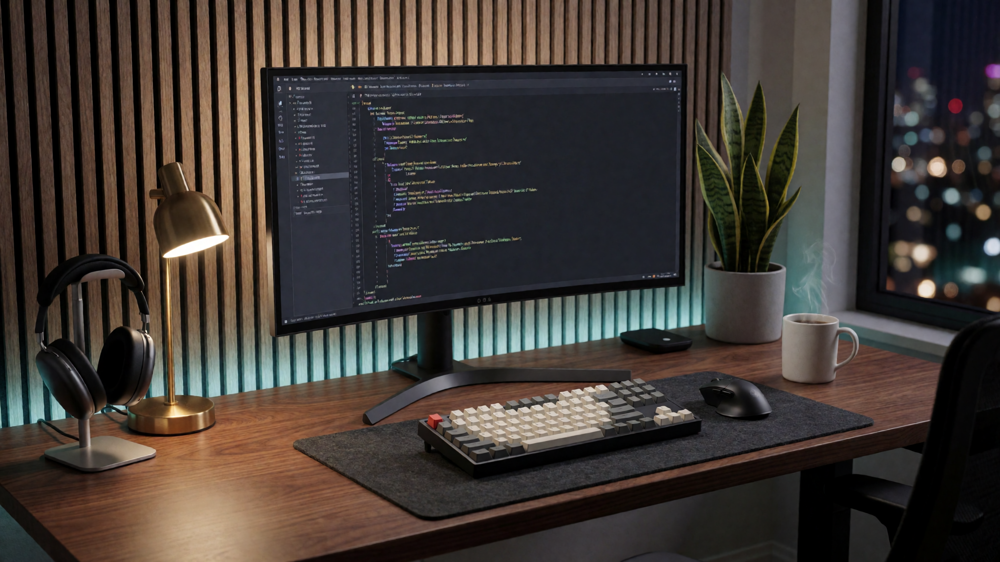
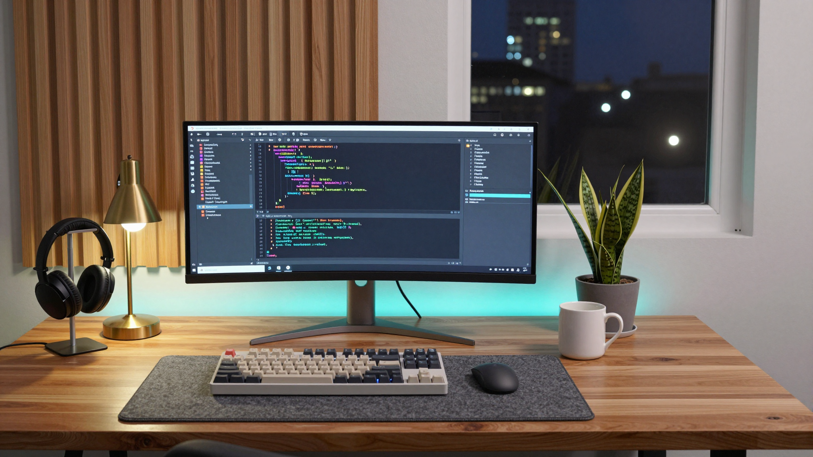
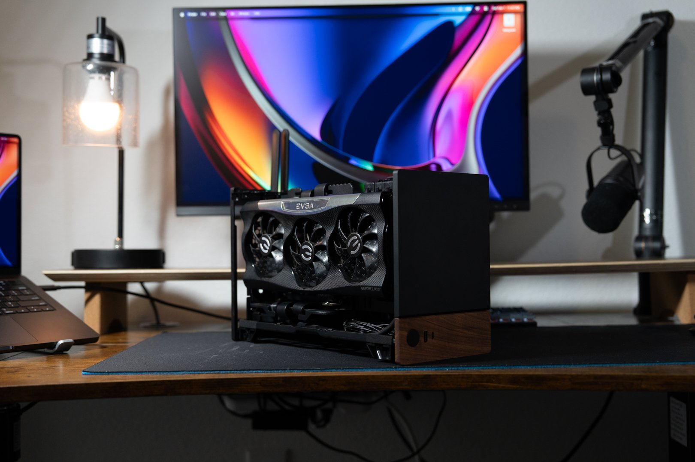
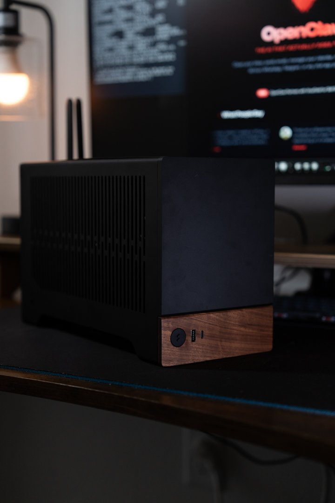
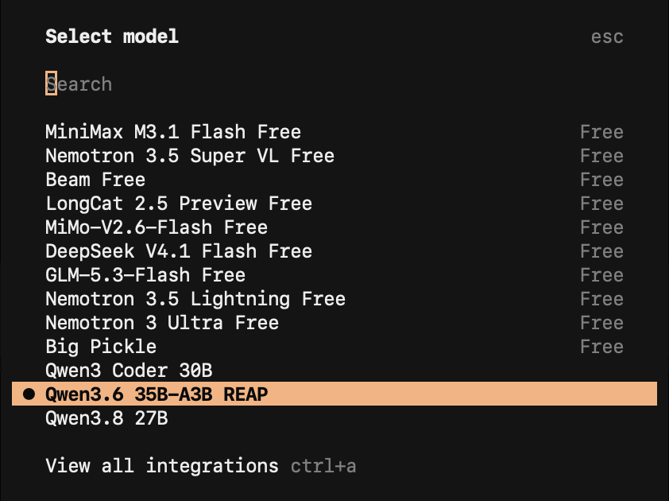

# RigUp

Got a gaming GPU? Run one install script and start using local AI models: chat, coding, images and video, all switched from a web page.

No setup, no config files to learn. RigUp installs the driver, Docker and the engines, then gives you a dashboard. Pick a model and it downloads whatever is missing, stops whatever currently holds the card, and starts the new one. A gaming card holds one big model at a time, so that's how RigUp runs them. The recipes (launch flags, quantization, context length) are tuned for 24 GB cards and come with suggested options for 16 GB and 12 GB cards.



*Example: Qwen3.6 REAP serving on an RTX 3090. The tabs at the top switch between the 24, 16 and 12 GB recipe sets.*

## What you get

| Port | Service | When it's up | What it's for |
|---|---|---|---|
| **8090** | Dashboard | Always | This page: switch models, install and remove them, watch VRAM, load, temperature, power and disk. Password protected. Change it with `RIGUP_PORT`. |
| **3000** | Open WebUI | Always | ChatGPT-style chat in the browser. It talks to whichever Lab model is running. |
| **8000** | LLM API | Only while a Lab model is running | OpenAI-compatible API (`http://<server>:8000/v1`). Point coding agents, scripts or apps at it. The model name is the recipe id, for example `qwen3.6-reap`. |
| **8188** | ComfyUI | Only while ComfyUI mode is running | Node-based image and video generation. |

Ports 8000 and 8188 are never up at the same time, because each one needs the whole GPU.

## Requirements

- Ubuntu 22.04 or newer (other distros may work; the installer is written for apt)
- One NVIDIA GPU with 12 GB VRAM or more
- 32 GB system RAM recommended (the 12 and 16 GB recipes keep part of the model in RAM)
- Disk: about **60 GB for the engines** (vLLM image ~28 GB, ComfyUI ~19 GB, llama.cpp ~7 GB, Open WebUI ~7 GB), plus 10 to 45 GB per model you install. Plan for 200 GB or more.
- SSH access with a user that can `sudo`

## What to expect on a 24 GB card

Measured on an RTX 3090 (24 GB) with the default 24 GB recipes.

### LLM speed

| Model | Tokens per second | A 1,000 token answer |
|---|---|---|
| Qwen3 Coder 30B | 185 tok/s | about 5 s |
| Qwen3.6 REAP | 165 tok/s | about 6 s |
| Qwen3.8 27B 256K | 91 tok/s (33 tok/s with 250K of context filled) | about 11 s |
| Qwen3.8 27B | 70 tok/s | about 14 s |

### Image samples

Same four prompts on each model, at 2K. Times are per image with the model already loaded; the first image after a switch adds the model load. The prompts and settings are in [`docs/samples/generate.py`](docs/samples/generate.py) and [`generate_others.py`](docs/samples/generate_others.py), so you can rerun them.

| | FLUX 3 Klein (16 steps) | Krea 2 Turbo (8 steps) | Z-Image Turbo (8 steps) |
|---|---|---|---|
| **Landscape** 2048×1152 |  36 s |  48 s |  18 s |
| **Portrait** 1536×2048 |  50 s |  66 s |  28 s |
| **Travel** 2048×1360 |  44 s |  59 s |  24 s |
| **Desk** 2048×1152 |  36 s |  48 s |  21 s |

Click an image for the full resolution file. A second seed of each is in [`docs/samples/alternates/`](docs/samples/alternates/). The sample images are free to reuse.

## The reference build

Every number in this README was measured on this PC: a small form factor box that sits on a desk and is used over the network.

| Open | Closed |
|---|---|
|  |  |

| Part | Model | Approx. price (US, Oct 2026) |
|---|---|---|
| GPU | NVIDIA RTX 3090 24 GB (EVGA FTW3), bought used | $1,200 to $1,500 |
| CPU | AMD Ryzen 5 9600X, 6 cores | $180 |
| CPU cooler | Any low profile cooler that fits the case (the 9600X ships without one) | $40 to $60 |
| Motherboard | Gigabyte A620I AX (mini ITX, AM5, Wi-Fi) | $120 to $150 |
| RAM | 32 GB DDR5-6000 (2 × 16 GB, TeamGroup) | $430 to $500 |
| SSD | Samsung 990 EVO 1 TB NVMe | $120 to $150 |
| Power supply | 750 W SFX | $140 to $170 |
| Case | Fractal Design Terra (mini ITX, 10.4 L) | $200 |
| **Total** | | **about $2,400 to $2,900** |

Prices move fast right now: RAM prices roughly tripled during 2026 because of AI demand for memory, SSDs went up too, and used 3090s climbed for the same reason. Check current listings before buying. The GPU is most of the cost; everything else is ordinary gaming PC parts.

**Why these parts:**

- **The GPU sets the limits.** VRAM decides which models fit, and memory bandwidth decides how fast they write. The 3090's 24 GB and 936 GB/s match the newer RTX 4090 on capacity and come close on bandwidth, at a fraction of the price used.
- **The CPU barely matters.** The models run on the GPU. A 6 core chip is plenty.
- **32 GB of RAM** is the practical minimum. The 12 and 16 GB card recipes keep part of the model in system RAM, and model files pass through RAM when loading.
- **A fast NVMe SSD** makes model switches quicker. A 20 GB model reads from disk in a few seconds; most of a switch is the engine starting up.
- **750 W is enough** for a 3090 (up to 350 W stock, 420 W on this EVGA card) plus a 65 W CPU. Use a quality unit: 3090s have short power spikes well above their rating.

**Key specs:**

| | Spec | Measured on this build |
|---|---|---|
| GPU memory | 24 GB GDDR6X, 384-bit, **936 GB/s** | |
| GPU to CPU link | PCIe 4.0 x16, about 32 GB/s each way | |
| GPU power | 350 W reference, 420 W limit on the EVGA FTW3 | |
| SSD | PCIe 4.0 x4 NVMe, up to **5,000 MB/s read, 4,200 MB/s write** | 2.6 GB/s read, 3.3 GB/s write (single stream, `dd` with direct I/O) |

The SSD's rated speeds need many reads in parallel; a single stream like loading one model file gets about half. That's still a 20 GB model in under 10 seconds.

## Install

```bash
git clone https://github.com/guscanales/rigup.git
cd rigup
./install.sh
```

The installer:

1. Installs the NVIDIA driver if `nvidia-smi` doesn't work yet. A new driver needs a reboot, so it stops and asks you to reboot and run `./install.sh` again.
2. Installs Docker and the NVIDIA Container Toolkit, then checks that a container can see the GPU.
3. Asks for a dashboard password (stored hashed in `data/config.json`).
4. Starts Open WebUI on port 3000.
5. Installs the dashboard as a systemd service (`rigup`) that starts at boot.

It doesn't download any models. Each model downloads the first time you use it.

Options, set before running:

```bash
RIGUP_PORT=9000 ./install.sh          # dashboard on another port
RIGUP_DATA=/mnt/big ./install.sh      # keep models on another disk
```

## Using it

Open `http://<server-ip>:8090`, log in with any username and your password.

- **Lab card (LLMs):** tap a model, then tap again to confirm. If its files aren't on disk yet, the button says `Get 16 GB + switch` and the download happens first; progress shows in the row and in the Console panel. Once it says Active, the API on :8000 and Open WebUI on :3000 answer with that model.
- **ComfyUI card (images and video):** install the packs you want with `Install`, then press `Switch to ComfyUI`. Each pack tells you which template or workflow to open in ComfyUI. The first ComfyUI start installs ComfyUI itself and takes several minutes.
- **Free GPU** stops whatever is running.
- **Remove** deletes a model's files. Files that another installed model shares (for example the same text encoder) are kept.
- **Tabs 24 GB / 16 GB / 12 GB** show the recipes for each card size. Your own card's tab is marked "yours". Recipes for a bigger card than yours are shown for reference but can't be started.

### Gated models

FLUX 3 Klein and LTX-2.5 require accepting a license on Hugging Face before download:

1. Sign in at huggingface.co and accept the license on [flux-3-image-klein-comfy](https://huggingface.co/black-forest-labs/flux-3-image-klein-comfy) and [LTX-2.5](https://huggingface.co/Lightricks/LTX-2.5).
2. Create a read token at [huggingface.co/settings/tokens](https://huggingface.co/settings/tokens).
3. Paste it in the dashboard (Open panel, "Hugging Face token") and press Save.

If you skip this, the download stops with a message telling you which page to accept.

## Use it from a coding agent

The LLM API on :8000 works with coding agents and other harnesses. It speaks the OpenAI API (`/v1/chat/completions`), and both engines also speak the Anthropic Messages API (`/v1/messages`), so Claude Code connects directly with no proxy.



*OpenCode with the RigUp models added next to its cloud models.*

Three things to know first:

- **The model name is the recipe id:** `qwen3-coder-30b`, `qwen3.6-reap`, `qwen3.8-27b`, and so on. The dashboard's Open panel shows the one that's running.
- **Only the running model answers.** If an agent asks for a model that isn't loaded, the request fails. Switch to it in the dashboard first.
- **No API key is checked.** Harnesses that insist on one accept any placeholder. Keep port 8000 off the internet (see [Security](#security)).

**Which model for agents:** `qwen3-coder-30b` is the fastest with solid tool calling. `qwen3.6-reap` is the best all-rounder, with 256K context and image input, which helps with big repos and screenshots. `qwen3.8-27b` is the smartest, but its 38K context is too small for agents with large system prompts like Claude Code; use `qwen3.8-27b-gguf` (256K) for that.

In the examples below, replace `<server-ip>` with your server's address.

### Claude Code

Set these environment variables, either in your shell for one session or in the `env` block of `~/.claude/settings.json` to make it permanent:

```bash
export ANTHROPIC_BASE_URL=http://<server-ip>:8000
export ANTHROPIC_AUTH_TOKEN=local
export ANTHROPIC_MODEL=qwen3.6-reap
export ANTHROPIC_DEFAULT_HAIKU_MODEL=qwen3.6-reap   # background tasks use the same local model
claude
```

Unset them (or remove the `env` block) to go back to Claude. Claude Code is tuned for Claude models, so expect a local model to need more guidance and to make more tool call mistakes.

### OpenCode

Add a provider to `~/.config/opencode/opencode.json`:

```json
{
  "$schema": "https://opencode.ai/config.json",
  "provider": {
    "rigup": {
      "npm": "@ai-sdk/openai-compatible",
      "name": "RigUp",
      "options": { "baseURL": "http://<server-ip>:8000/v1", "apiKey": "local" },
      "models": {
        "qwen3-coder-30b": { "name": "Qwen3 Coder 30B", "limit": { "context": 81920, "output": 8192 } },
        "qwen3.6-reap": {
          "name": "Qwen3.6 35B-A3B REAP",
          "limit": { "context": 262144, "output": 16384 },
          "modalities": { "input": ["text", "image"], "output": ["text"] },
          "attachment": true
        },
        "qwen3.8-27b": { "name": "Qwen3.8 27B", "limit": { "context": 38912, "output": 8192 } }
      }
    }
  },
  "model": "rigup/qwen3.6-reap"
}
```

Then pick the model with `/models`. Setting `limit.context` matters: OpenCode uses it to decide when to compact the conversation.

### Hermes Agent

Run `hermes model`, choose **Custom endpoint (self-hosted / VLLM / etc.)**, enter `http://<server-ip>:8000/v1`, skip the API key, and enter the model name. Or edit `~/.hermes/config.yaml`:

```yaml
model:
  default: qwen3.6-reap
  provider: custom
  base_url: http://<server-ip>:8000/v1
  context_length: 262144
```

Set `context_length` yourself: Hermes otherwise guesses from the server and may pick a smaller window.

### OpenClaw

Add a provider to `~/.openclaw/openclaw.json` and make it the default model:

```json
{
  "models": {
    "providers": {
      "rigup": {
        "baseUrl": "http://<server-ip>:8000/v1",
        "apiKey": "local",
        "api": "openai-completions",
        "timeoutSeconds": 300,
        "models": [
          { "id": "qwen3.6-reap", "name": "Qwen3.6 REAP (RigUp)", "reasoning": true, "input": ["text", "image"],
            "cost": { "input": 0, "output": 0, "cacheRead": 0, "cacheWrite": 0 },
            "contextWindow": 262144, "maxTokens": 16384 }
        ]
      }
    }
  },
  "agents": { "defaults": { "model": { "primary": "rigup/qwen3.6-reap" } } }
}
```

### Anything else

Any tool with an "OpenAI compatible" option works the same way: base URL `http://<server-ip>:8000/v1`, any API key, model name = recipe id. Quick test from the command line:

```bash
curl http://<server-ip>:8000/v1/chat/completions -H 'Content-Type: application/json' \
  -d '{"model": "qwen3.6-reap", "messages": [{"role": "user", "content": "Say hi"}]}'
```

## The models

The status badge on each row says how much to trust the numbers:

- **measured**: run and timed on that card size (all measured on an RTX 3090, 24 GB)
- **runs**: run on that card size, not timed yet
- **estimate**: sized on paper, not run on that card size yet. Expect to adjust the context length if it runs out of memory.

### Lab (LLMs, served on :8000)

| Model | Card | Engine | Quant | Context | Speed | VRAM | Download | Status | Good for |
|---|---|---|---|---|---|---|---|---|---|
| Qwen3.6 REAP | 24 GB | vLLM | 35B-A3B pruned to 26B, W4A16 | 256K | 165 tok/s | 21.6 GB | 16.3 GB | measured | Everyday pick: fast, long context, sees images, reliable tool calls |
| Qwen3 Coder 30B | 24 GB | vLLM | 30B-A3B, AWQ 4-bit | 80K | 185 tok/s | 22.6 GB | 16.8 GB | measured | Coding agents; coder-tuned with solid tool calling |
| Qwen3.8 27B | 24 GB | vLLM | 27B dense, INT4 + MTP | 38K | 70 tok/s | 23.5 GB | 19.5 GB | measured | Hardest reasoning; text only |
| Qwen3.8 27B 256K | 24 GB | llama.cpp | 27B dense, UD-Q3_K_XL + MTP | 256K | 91 tok/s (33 at 250K) | 21.9 GB | 15.4 GB | measured | Same 27B with full context and vision |
| Qwen3.6 35B-A3B | 16 GB | llama.cpp | MoE, UD-Q3_K_XL | 64K | | ~15 GB + RAM | 17.7 GB | estimate | Best quality for 16 GB; experts that don't fit live in RAM |
| Qwen3.8 27B Q2 | 16 / 12 GB | llama.cpp | 27B dense, UD-Q2_K_XL | 32K | | ~11.5 GB | 10.7 GB | estimate | Smart dense model fully on the GPU, at some quality cost |
| Qwen3.6 35B-A3B Q2 | 12 GB | llama.cpp | MoE, UD-Q2_K_XL | 32K | | ~11.5 GB + RAM | 13.2 GB | estimate | Long answers on a 12 GB card; experts spill to RAM |

All Lab models are Apache 2.0. The 16 and 12 GB recipes use llama.cpp's `--fit on`, which sizes the GPU part automatically and keeps the rest in system RAM.

### ComfyUI (images and video, on :8188)

| Pack | Type | Steps | Time (1024²) | Max size | Download | Cards | License | Open in ComfyUI |
|---|---|---|---|---|---|---|---|---|
| Z-Image Turbo | image | 8 | 8 s | 2048² | 20.6 GB | 24 measured, 16 estimate | Apache 2.0 | Template `image_z_image_turbo` |
| FLUX 3 Klein | image, edit | 16 | | 4K | 20.7 GB | 24 runs, 16 and 12 estimate | FLUX Kommunity, free under $5M revenue. **Gated** | Workflows `flux3_klein_int8_t2i`, `_i2i`, `_mi2i` |
| FLUX 3 Klein Base | image | 50 | | 4K | 20.7 GB | 24 runs, 16 estimate | Same as Klein. **Gated** | Workflow `flux3_klein_base_int8_t2i` |
| Krea 2 Turbo | image | 8 | | 2048² | 19.9 GB | 24 runs, 16 estimate | Krea community | Template `image_krea2_turbo_t2i_int8` (not the plain one, it wants fp8 files) |
| Qwen-Image 2.1 Turbo | image, edit, text in images | 8 | 13 s | 2048² | 36.3 GB | 24 measured, 16 and 12 estimate | Qwen research license, **no commercial use** | Templates `image_qwen_image_2_1_turbo_t2i`, `..._turbo_image_edit` |
| Qwen-Image 2.1 | image | 25 | | 2048² | 26.8 GB | 24 runs, 16 estimate | Qwen research license, **no commercial use** | Template `image_qwen_image_2_1_t2i` |
| LTX-2.5 | video + audio | | | 1080p | 45 GB | 24 estimate | LTX-2 Community, free under $10M revenue. **Gated** | Templates `video_ltx2_5_t2v`, `video_ltx2_5_i2v` |
| SeedVR2 3B | upscaler | | | | 4 GB | all estimate | Apache 2.0 | Template `utility_seedvr2_3b_int8_upscale_video` |

Download sizes count each pack on its own; packs that share files (Klein and Klein Base, the two Qwen-Image packs) download those files once.

**Licenses matter.** The weights are downloaded from their publishers under their own licenses; this project doesn't redistribute them. Read each license before using outputs commercially.

### Model sources

Each model's original release on Hugging Face, and the repo the dashboard downloads from (a quantized or ComfyUI-packaged build of the original).

| Model | Original release | Downloaded from |
|---|---|---|
| Qwen3.6 REAP | [Qwen/Qwen3.6-35B-A3B](https://huggingface.co/Qwen/Qwen3.6-35B-A3B) | [atbender/Qwen3.6-VL-REAP-26B-A3B-W4A16](https://huggingface.co/atbender/Qwen3.6-VL-REAP-26B-A3B-W4A16) (expert-pruned, 4-bit) |
| Qwen3 Coder 30B | [Qwen/Qwen3-Coder-30B-A3B-Instruct](https://huggingface.co/Qwen/Qwen3-Coder-30B-A3B-Instruct) | [QuantTrio/Qwen3-Coder-30B-A3B-Instruct-AWQ](https://huggingface.co/QuantTrio/Qwen3-Coder-30B-A3B-Instruct-AWQ) |
| Qwen3.8 27B | [Qwen/Qwen3.8-27B](https://huggingface.co/Qwen/Qwen3.8-27B) | [RedHatAI/Qwen3.8-27B-INT4](https://huggingface.co/RedHatAI/Qwen3.8-27B-INT4) |
| Qwen3.8 27B 256K, Qwen3.8 27B Q2 | [Qwen/Qwen3.8-27B](https://huggingface.co/Qwen/Qwen3.8-27B) | [unsloth/Qwen3.8-27B-GGUF](https://huggingface.co/unsloth/Qwen3.8-27B-GGUF) |
| Qwen3.6 35B-A3B, Qwen3.6 35B-A3B Q2 | [Qwen/Qwen3.6-35B-A3B](https://huggingface.co/Qwen/Qwen3.6-35B-A3B) | [unsloth/Qwen3.6-35B-A3B-GGUF](https://huggingface.co/unsloth/Qwen3.6-35B-A3B-GGUF) |
| Z-Image Turbo | [Tongyi-MAI/Z-Image-Turbo](https://huggingface.co/Tongyi-MAI/Z-Image-Turbo) | [Comfy-Org/z_image_turbo](https://huggingface.co/Comfy-Org/z_image_turbo) |
| FLUX 3 Klein | [black-forest-labs/flux-3-image-klein](https://huggingface.co/black-forest-labs/flux-3-image-klein) | [black-forest-labs/flux-3-image-klein-comfy](https://huggingface.co/black-forest-labs/flux-3-image-klein-comfy) |
| FLUX 3 Klein Base | [black-forest-labs/flux-3-image-klein-base](https://huggingface.co/black-forest-labs/flux-3-image-klein-base) | [black-forest-labs/flux-3-image-klein-comfy](https://huggingface.co/black-forest-labs/flux-3-image-klein-comfy) |
| Krea 2 Turbo | [krea/Krea-2-Turbo](https://huggingface.co/krea/Krea-2-Turbo) (base: [krea/Krea-2-Raw](https://huggingface.co/krea/Krea-2-Raw)) | [Comfy-Org/Krea-2](https://huggingface.co/Comfy-Org/Krea-2) |
| Qwen-Image 2.1 Turbo | [Qwen/Qwen-Image-2.1-Turbo](https://huggingface.co/Qwen/Qwen-Image-2.1-Turbo), prompt enhancers [Qwen/Qwen-Image-2.1-PE-T2I](https://huggingface.co/Qwen/Qwen-Image-2.1-PE-T2I) and [Qwen/Qwen-Image-2.1-PE-I2I](https://huggingface.co/Qwen/Qwen-Image-2.1-PE-I2I) | [Comfy-Org/Qwen-Image-2.1](https://huggingface.co/Comfy-Org/Qwen-Image-2.1) |
| Qwen-Image 2.1 | [Qwen/Qwen-Image-2.1](https://huggingface.co/Qwen/Qwen-Image-2.1) | [Comfy-Org/Qwen-Image-2.1](https://huggingface.co/Comfy-Org/Qwen-Image-2.1) |
| LTX-2.5 | [Lightricks/LTX-2.5](https://huggingface.co/Lightricks/LTX-2.5) | [Lightricks/LTX-2.5](https://huggingface.co/Lightricks/LTX-2.5), plus the Gemma 4 E2B text encoder from [Comfy-Org/gemma-4](https://huggingface.co/Comfy-Org/gemma-4) (original: [google/gemma-4-E2B-it](https://huggingface.co/google/gemma-4-E2B-it)) |
| SeedVR2 3B | [ByteDance-Seed/SeedVR2-3B](https://huggingface.co/ByteDance-Seed/SeedVR2-3B) | [Comfy-Org/SeedVR2](https://huggingface.co/Comfy-Org/SeedVR2) |

Engines: [vLLM](https://github.com/vllm-project/vllm), [llama.cpp](https://github.com/ggml-org/llama.cpp), [ComfyUI](https://github.com/Comfy-Org/ComfyUI) (run with the [mmartial/comfyui-nvidia-docker](https://github.com/mmartial/ComfyUI-Nvidia-Docker) image), [Open WebUI](https://github.com/open-webui/open-webui).

## Files on disk

```
rigup/
├── install.sh          one-time setup
├── server.py           dashboard + API (Python standard library only)
├── recipes.json        every model: files, launch flags, sizes, measured numbers
├── web/                the dashboard page
└── data/               created at install; not in git
    ├── config.json     password hash, Hugging Face token (chmod 600)
    ├── models/         LLM weights, by Hugging Face repo
    ├── comfyui/        ComfyUI install, model packs, workflows, outputs
    ├── open-webui/     chat history and accounts
    ├── cache/          vLLM compile cache, so later starts are faster
    └── installed/      one marker file per finished download
```

## Adding a model

Add an entry to `recipes.json` and restart the service (`sudo systemctl restart rigup`). Look at a similar existing entry and copy its shape:

- vLLM models list the Hugging Face repo (`{"repo": "org/name"}`) and the vLLM flags in `args`.
- llama.cpp models list each GGUF file (`{"url": ..., "to": "models/org/name/file.gguf"}`) and the llama-server flags.
- ComfyUI packs list each file and the ComfyUI folder it goes in (`{"url": ..., "dir": "diffusion_models"}`).
- `fit` says which card sizes it's meant for and how sure you are.

## Security

The dashboard can start, stop and delete things, so it always asks for a password. It uses HTTP basic auth without TLS, which is fine on a home network or over a VPN such as Tailscale. Don't expose port 8090 to the internet.

ComfyUI (:8188) and the LLM API (:8000) have no login of their own, so keep the server on a trusted network or behind a firewall. Open WebUI (:3000) has its own accounts; the first account you create becomes the admin.

## Troubleshooting

- **A model fails to start:** the Console shows the engine's last log lines. Out-of-memory usually means the context is too long for your card; lower `-c` (llama.cpp) or `--max-model-len` (vLLM) in `recipes.json`.
- **Service logs:** `journalctl -u rigup -f`
- **Something else is using the GPU:** `nvidia-smi` lists the processes. RigUp only stops its own containers (`rigup-llm`, `rigup-comfy`).
- **Download stopped halfway:** press the button again. Downloads resume where they stopped.

## Uninstall

```bash
sudo systemctl disable --now rigup
sudo rm /etc/systemd/system/rigup.service
docker rm -f rigup-llm rigup-comfy rigup-webui
rm -rf data/            # deletes every downloaded model and chat history
```

Docker, the NVIDIA driver and the container toolkit stay installed.
